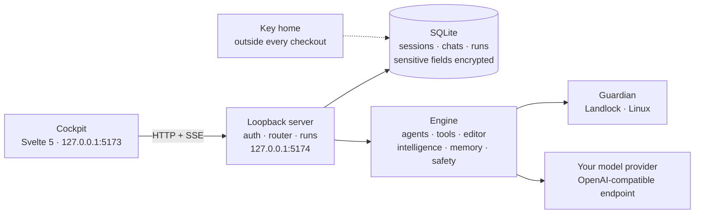

<p align="center">
  
</p>

<h1 align="center">Bridlewise</h1>

<p align="center"><strong>Every run, recorded. Every tool, governed.</strong><br>
A local-first coding cockpit for working with language models on real repositories.</p>

<p align="center">
  <a href="https://github.com/LLM-4-People/bridlewise/actions/workflows/ci.yml"></a>
  <a href="https://github.com/LLM-4-People/bridlewise/actions/workflows/codeql.yml"></a>
  
  
  
</p>

> [!WARNING]
> **Bridlewise is an experimental developer preview. It is not production-ready, and it is not safe for sensitive code.**
>
> The engine is **pre-admission**: its readiness receipt currently reports `harnessReady: false`, and interactive capabilities remain behind an open governance gate. There has been **no security audit**. Expect breaking changes, incomplete flows, and **data loss**.
>
> **Do not use Bridlewise on proprietary, regulated, client-confidential, or production codebases.** Run it on a disposable copy, in a disposable environment, with credentials you can revoke. Keep your own backups and use version control. Read [Security and limits](docs/security.md) before you run anything important.

Bridlewise is a coding harness you run on your own machine. A conversation becomes a **run**: an executable, recorded unit of work that streams the model's words, every tool call, every file effect, every check, and every finding into one causal timeline. Tools are not handed to the model as an open-ended shell; they pass through a registry, typed pre-dispatch checks, runtime detectors, and (on Linux) an OS-level filesystem boundary. The cockpit is the instrument panel for that run — not a chat box with a file tree bolted on.

It is built for people who want to inspect the machinery: developers evaluating coding agents, agent-infrastructure engineers, and researchers who need provenance rather than a transcript. It is early, it is opinionated, and it is meant to be read as much as used.

## What is here

| Surface | What it does |
|---|---|
| **The run as the unit** | A run executes exactly once, owns its stream, and can be reopened without starting a second execution. The stream is the product; chat is one view of it. |
| **A causal record** | Turns, tool calls, file effects, check deltas, and findings share one ordered timeline. Each beat says what caused it and what it changed. |
| **A governed tool surface** | One registry, one executor, typed blockers. An unconfigured adapter refuses by name; it never silently falls back. `git_commit` is deliberately blocked — the model does not auto-commit. |
| **Gates before and during dispatch** | Ghost-tool and schema checks run before a call; bias, deviation, bandaid, workaround, and step-skip detectors watch a turn as it streams. |
| **Code intelligence** | Repository maps, symbol search, dependency graphs (including cycles), data flow, reuse discovery, and AST-accurate slices — backed by tree-sitter. |
| **A transactional editor** | One `edit` tool plans, applies, and validates exact replacements, with rollback and a reviewable diff. |
| **Memory with provenance** | Tool results and attempt history can be retained and recalled across runs and chats, with the ledger remaining the record of what happened. |
| **Local by construction** | A loopback-only HTTP+SSE server, SQLite state, encrypted sensitive fields, and database keys kept outside every checkout. No hosted service is required. |
| **Landlock confinement (Linux)** | On Linux, the Landlock guardian confines server-spawned shell commands and stdio MCP servers to the selected project. The CLI itself is not re-exec'd under the guardian. |

## What makes it different

| A typical coding agent | Bridlewise |
|---|---|
| The chat is the product; tool calls scroll past. | The **run** is the product; the conversation is one projection of a recorded causal stream. |
| Tool output is ephemeral, or lives in a provider's logs. | Every run, tool call, effect, check, and finding is written to an **append-only local timeline**. |
| A missing integration falls back to something plausible. | A missing adapter returns a **typed blocker** that names what is missing and where to configure it. |
| Safety is a permission prompt, or a post-hoc review. | Gates act **before dispatch and during the stream**; the shell is confined by the OS on Linux. |
| Logs are a side channel. | The record **is** a first-class surface: rewind, replay, and inspect the actual edge. |
| A new capability means hand-wiring a route, schema, client, and UI. | One **block declaration** in `server/blocks/` projects the route, input schema, client, and UI. |
| Your code and keys live wherever the app puts them. | State stays in a local SQLite database; **keys live in a key home outside the checkout**; the server binds to `127.0.0.1` by default. |

## A first look

| The flow | The switch |
|---|---|
|  |  |

| The instruments | Settings |
|---|---|
|  |  |

The interface is **instrument glass over a paper logbook**: carbon dark grounds, engraved labels, one live beam (`#8fd3ff`) reserved for what is actually happening, IBM Plex Sans and Mono, and a light "logbook" theme that is a real paper surface rather than an inversion. Read [Design](docs/design.md) for the principles and tokens.

## Build on it

The CLI, the dev lifecycle, and the extension points are part of the shipped tree, not an afterthought:

```bash
./bin/bridlewise.mjs --help          # top-level commands
./bin/bridlewise.mjs preflight       # the honest readiness receipt
./bin/bridlewise.mjs harness         # every workflow verb
npm run test:public                  # the fresh-clone smoke suite
./bin/bridlewise.mjs harness new-module path/to/module
```

- **CLI and scripts:** [CLI reference](docs/cli.md) covers `preflight`, `quality`, every `harness` verb, `sd.mjs`, `trace.ts`, `db-key`, the guardian, and exit codes.
- **Tests:** [Testing](docs/testing.md) explains the public smoke suite, the development floor, the 4.1 GB corpus and performance-report prerequisites, how to add a test, and the anti-flake rules.
- **Extensions:** [Building on the harness](docs/extending.md) covers blocks, tools, providers, MCP servers, embedding the engine, quality packs, and the conventions that keep one owner per fact.
- **Shipping:** [Shipping and releases](docs/shipping.md) lists the build outputs, verification gate, release assets, and rollback.

The public smoke tests verify the launcher, the typed `harness` refusal, the `preflight` receipt (`harnessReady: false`), the secret scanner's failure modes, and the docs. The full prevention/unit/benchmark floor is in [`bridlewise-testing`](https://github.com/LLM-4-People/bridlewise-testing).

## Architecture



The server is the trust boundary. The cockpit never talks to a model directly. The engine owns tool execution and analysis; the server owns sessions, policy, and the recording choke point. On Linux, server-spawned shell commands and stdio MCP servers can be confined by the Landlock guardian. The CLI itself is not re-exec'd under the guardian. A run's SSE stream is a subscriber to an execution that is already happening — a second viewer reads the record, it does not start a second run.

More: [Architecture](docs/architecture.md) · [Security and limits](docs/security.md) · [Products](PRODUCTS.md).

## Quickstart

**Requirements:** Node.js `>=24.18.0 <25.0.0`, npm, and Linux for the Landlock path. The preview targets Linux first; Windows and macOS can run parts of the stack but do not get OS-level confinement.

```bash
git clone https://github.com/LLM-4-People/bridlewise.git
cd bridlewise

npm ci
(cd engine && npm ci)
chmod 600 engine/bridlewise.config.json

node scripts/sd.mjs start
```

Open **http://127.0.0.1:5173**. Stop the servers with:

```bash
node scripts/sd.mjs stop
```

`sd.mjs` starts the API server and the Vite UI, waits for health, and stops only the processes this lifecycle started. Use `node scripts/sd.mjs status` before reaching for `kill`.

### First run

1. **Create the first account.** This account owns the harness and is the administrator. Open registration closes after the first user; later accounts are created by an administrator. There is no hosted recovery service.
2. **Add a model provider.** Open **Settings → Model providers**, then add a name, the API address (for example `https://your-provider.example/v1`), an API key, and at least one model id. Set a default model for new conversations. The provider is configured deliberately; there is no bundled fallback.
3. **Add a project.** Choose a disposable copy of a repository. Tools are scoped to the selected project, and the engine refuses paths outside it.
4. **Send a prompt.** Watch the run stream: the model turn, tool beats, file effects, check deltas, and findings appear in causal order. The sweep is the record.

If no provider is configured, the run refuses with `provider_not_configured` and names the remedy. For a UI-only demo without live model calls:

```bash
HARNESS_WEB_LLM_FIXTURES=1 node scripts/sd.mjs start
```

Fixture mode replaces the model stream with deterministic events, but provider and model resolution still happen first, and the endpoint is never called. It is for exercising the interface, not for evaluating model output.

**The configuration file must be mode `0600`.** The checked-in config enables self-protection, and the runtime fails closed with `config_mode_insecure` on any other mode. A fresh clone may materialize it as `0644` or `0664`; the `chmod` above is not optional.

Full setup, troubleshooting, and key-backup notes: [Quickstart](docs/quickstart.md).

## Status and limits

Bridlewise is **pre-1.0 and pre-admission**. The engine's preflight is an integrity receipt, not a readiness certificate: `harnessReady` is `false`, and interactive capabilities are reported `deny` until the governance gate admits them. The web harness runs as a developer preview around that gate. Treat every result as experimental evidence, not a product.

Known limits, stated plainly:

- **No security audit.** No third-party review, no penetration test, no certification. The threat model is in [docs/security.md](docs/security.md).
- **No signed releases and no hosted demo.** Build from source, or inspect the unsigned preview snapshots attached to [the release](https://github.com/LLM-4-People/bridlewise/releases). There are no installers, signed binaries, or hosted accounts.
- **Linux-first.** Landlock confinement is a Linux feature. WSL2 support depends on the host kernel and Landlock ABI; when unavailable, the guardian fails closed. Native Linux is the supported path today.
- **Not multi-tenant hardened.** Multiple local users are modeled, but isolation between mutually distrusting tenants has not been audited.
- **No audit guarantee.** The timeline is append-only at the application layer and is not a cryptographically signed, tamper-evident compliance log. It is not a substitute for your organization's audit system.
- **Provider coverage is narrow.** Providers must speak the OpenAI Responses or Chat Completions protocols. Anthropic-native and Gemini-native adapters are not verified here.
- **The full prevention suite is not in this repository.** It lives in [`bridlewise-testing`](https://github.com/LLM-4-People/bridlewise-testing); a fresh clone of this repo does not reproduce the complete test inventory.
- **Breaking changes are expected.** Database schemas, configuration, routes, and behavior can change without migration promises. Back up the key home and keep disposable copies.

## Who it is for — and who it is not for

**For:** developers evaluating how coding agents actually behave; agent-infrastructure engineers who want to inspect tool governance and provenance; researchers who need a recorded causal stream; contributors who enjoy reading the machinery and improving it.

**Not for:** teams looking for a supported production tool; anyone who needs to point an agent at proprietary or regulated code today; people who want a polished IDE replacement; anyone expecting a drop-in Copilot alternative; anyone who needs Windows or macOS filesystem confinement; anyone who needs a hosted, multi-tenant service.

## Repository map

Bridlewise is split across two public repositories:

- **[`bridlewise`](https://github.com/LLM-4-People/bridlewise)** — the product. This is the tree that builds, serves, and runs: the Svelte cockpit (`src/`), the loopback server (`server/`), the engine (`engine/`), the Landlock guardian (`engine/guardian/`), shared wire contracts (`shared/`), lifecycle scripts (`scripts/`), and this documentation site (`docs/`).
- **[`bridlewise-testing`](https://github.com/LLM-4-People/bridlewise-testing)** — the development floor. It carries the prevention suite, benchmarks, verification tooling, curated design records, and the decision log. The public product tree is a curated projection of the development floor. Start there if you want to see how claims are tested or contribute a change.

The public product branch is `main`. The private development history is not published; the development floor is available as a separate public repository. The private promotion tooling is described in [Architecture](docs/architecture.md#shipping) as maintainer context; it is not part of the public release process.

## Documentation

- [Quickstart](docs/quickstart.md) — install, first account, providers, ports, fixtures, troubleshooting.
- [Architecture](docs/architecture.md) — cockpit, server, engine, guardian, storage, and the run/SSE flow.
- [Security and limits](docs/security.md) — threat model, key handling, Landlock, redaction, and what is not protected.
- [Design](docs/design.md) — the cockpit's principles, surfaces, tokens, and accessibility rules.
- [Roadmap](docs/roadmap.md) — honest status, known gaps, and near-term themes without dates.
- [FAQ](docs/faq.md) — readiness, providers, licensing, and the two-repository split.
- [CLI reference](docs/cli.md) — the CLI, dev lifecycle, ledger inspection, and guardian tools.
- [Testing](docs/testing.md) — the public smoke suite, the development floor, and how to add a test.
- [Building on the harness](docs/extending.md) — blocks, tools, providers, MCP, embedding, and quality packs.
- [Shipping and releases](docs/shipping.md) — build outputs, verification, release assets, and rollback.
- [Products](PRODUCTS.md) — every shipped surface with its path and status.
- [Changelog](CHANGELOG.md) — what changed, including the unglamorous parts.

## Security

Please do not open a public issue for a vulnerability. Read [SECURITY.md](SECURITY.md) for scope, the private advisory channel, and the limits of what has been reviewed. The short version: this is not audited, it must not hold sensitive code, and the local machine's user account is inside the trust boundary.

## Contributing

Contributions are welcome, especially reproducible bug reports, documentation corrections, and tests that protect a real failure mode. Read [CONTRIBUTING.md](CONTRIBUTING.md) and the [Code of Conduct](CODE_OF_CONDUCT.md) first. Development work lands on the testing floor, not directly on the product branch.

## License

Bridlewise is licensed under the **GNU Affero General Public License v3.0** (AGPL-3.0). See [LICENSE](LICENSE) or the [canonical license text](https://www.gnu.org/licenses/agpl-3.0.html). The AGPL's network-use clause applies if you modify Bridlewise and let others interact with it over a network.

<p align="center"><sub>Make room for good work.</sub></p>
