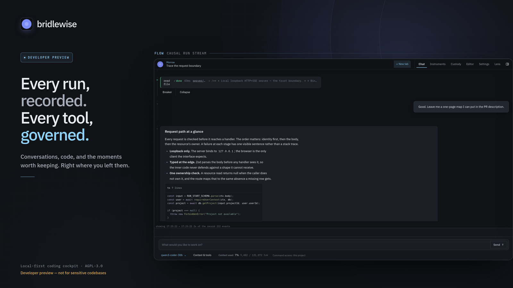
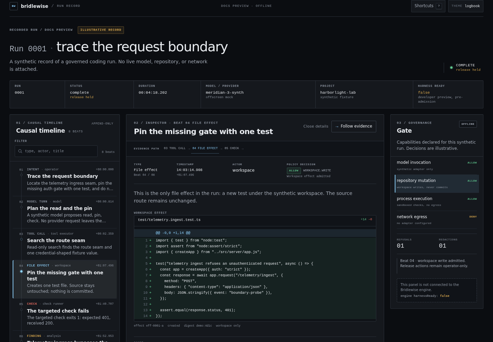
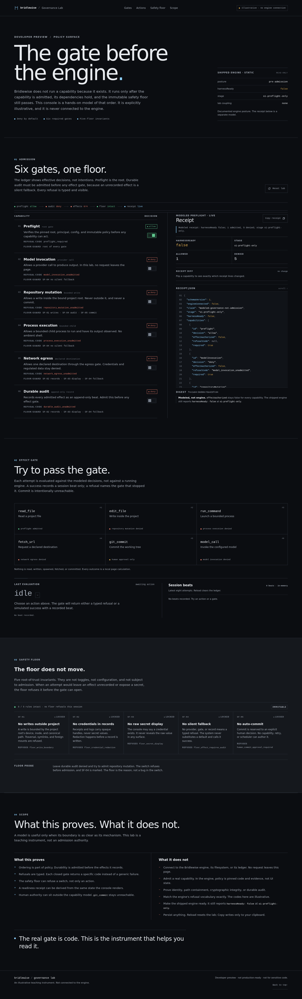
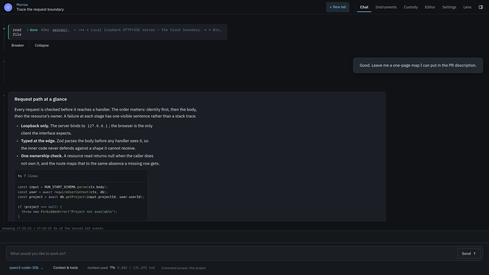
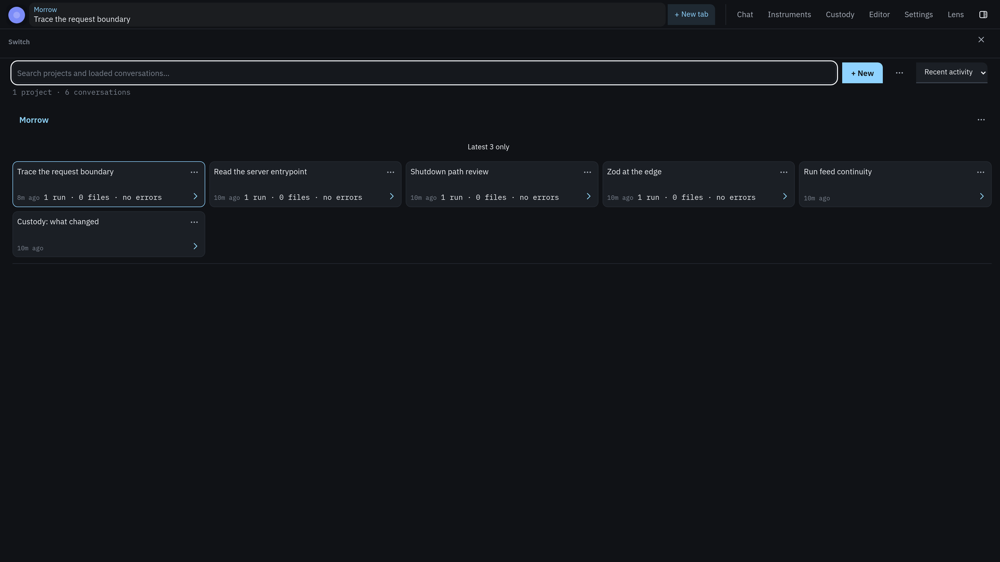
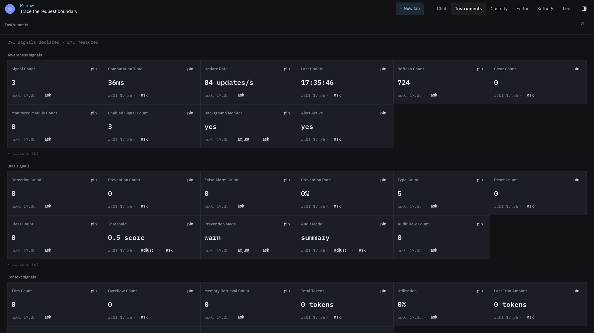
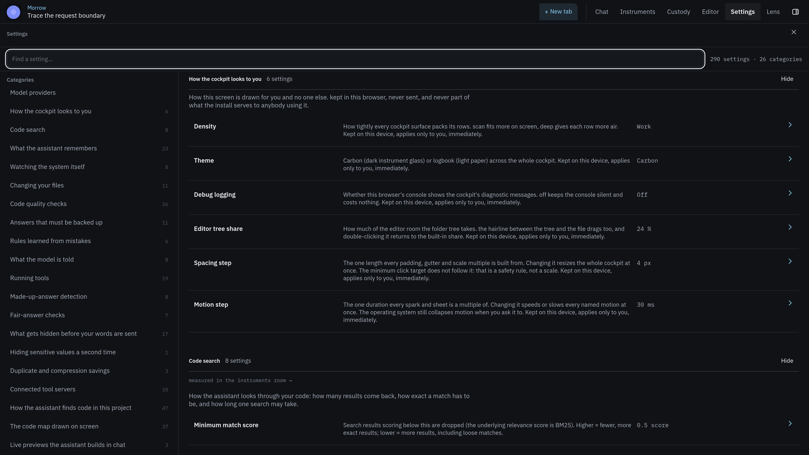
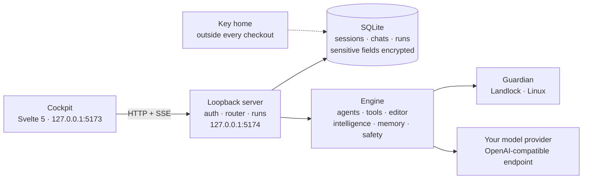

<p align="center">
  
</p>

<h1 align="center">Bridlewise</h1>

<p align="center"><strong>Every run, recorded. Every tool, governed.</strong><br>
A local-first coding cockpit for working with language models on real repositories.</p>

<p align="center">
  <a href="https://github.com/LLM-4-People/bridlewise/actions/workflows/ci.yml"></a>
  <a href="https://github.com/LLM-4-People/bridlewise/actions/workflows/codeql.yml"></a>
  <a href="https://scorecard.dev/viewer/?uri=github.com/LLM-4-People/bridlewise"></a>
  <a href="https://codespaces.new/LLM-4-People/bridlewise?quickstart=1"></a>
  <a href="https://github.com/LLM-4-People/bridlewise/discussions"></a>
  
  
  
</p>

> [!WARNING]
> **Bridlewise is an experimental developer preview. It is not production-ready, and it is not safe for sensitive code.**
>
> The engine is **pre-admission**: its readiness receipt reports `harnessReady: false`, and interactive capabilities remain behind an open governance gate. There has been **no security audit**. Expect breaking changes, incomplete flows, and **data loss**.
>
> **Do not use Bridlewise on proprietary, regulated, client-confidential, or production codebases.** Run it on a disposable copy, in a disposable environment, with credentials you can revoke. Keep your own backups and use version control. Read [Security and limits](https://llm-4-people.github.io/bridlewise/security/) before you run anything important.

The [roadmap](https://llm-4-people.github.io/bridlewise/roadmap/) names the milestones, gaps, and exit criteria. The [development floor](https://llm-4-people.github.io/bridlewise-testing/) is the contributor hub for testing, building on the harness, and the engineering work breakdown.

Bridlewise is a coding harness you run on your own machine. A conversation becomes a **run**: an executable, recorded unit of work that streams the model's words, every tool call, every file effect, every check, and every finding into one causal timeline. Tools are not handed to the model as an open-ended shell; they pass through a registry, typed pre-dispatch checks, runtime detectors, and (on Linux) an OS-level filesystem boundary. The cockpit is the instrument panel for that run — not a chat box with a file tree bolted on.

## The 90-second tour

The install takes longer than 90 seconds. The shape does not.

1. **A run is the unit.** It executes once, owns its stream, and can be reopened without starting a second execution.
2. **The record has eight beats.** Intent, boundary, tool, effect, check, finding, decision, release. Each beat says what caused it and what it changed.
3. **Tools are governed.** One registry, one executor, typed blockers. An unconfigured adapter refuses by name; it never silently falls back.
4. **Safety acts before and during the turn.** Ghost-tool and schema checks run before dispatch; bias, deviation, bandaid, workaround, and step-skip detectors watch a turn as it streams.
5. **The record is local.** Loopback server, SQLite state, keys outside the checkout, no hosted account.
6. **The preview is honest.** Pre-admission, unaudited, Linux-first for confinement, and expected to break. That is the current state, not a footnote.

## The run record

| # | Beat | What the record holds |
|---|---|---|
| 1 | **Intent** | The prompt, project, model, and plan — what the run is trying to do |
| 2 | **Boundary** | The provider, tool registry, policy, project root, and confinement decision |
| 3 | **Tool** | The registered tool, typed arguments, and the pre-dispatch gate's answer |
| 4 | **Effect** | A file diff, command result, or process effect — with a rollback handle where one exists |
| 5 | **Check** | The check, its before-and-after state, and the delta that actually moved |
| 6 | **Finding** | What a check or detector found, with its source and derivation |
| 7 | **Decision** | Allow, deny, stop, retry, or escalate — including the typed refusals |
| 8 | **Release** | What leaves the harness: a diff, a report, a commit, or a published artifact |

The cockpit is the instrument panel. The repository is the flight recorder. Both are meant to be read, not just watched.

The cockpit renders that sequence as a causal stream. The [interactive run](https://llm-4-people.github.io/bridlewise/run/) is a synthetic record of the same shape; the [policy lab](https://llm-4-people.github.io/bridlewise/policy-lab/) lets you toggle capabilities and watch a receipt refuse. Both are clearly labeled illustrations, not connected engines. The [repository itself is also a run record](https://llm-4-people.github.io/bridlewise/github/), with GitHub surfaces standing in for the beats.

| The interactive run | The policy lab |
|---|---|
| [](https://llm-4-people.github.io/bridlewise/run/) | [](https://llm-4-people.github.io/bridlewise/policy-lab/) |
| A synthetic run you can walk, beat by beat. | A console that refuses with a reason. |

## Three doors

| Door | What you do | Start |
|---|---|---|
| **Run it** | Clone a disposable copy, install Node 24, add a provider, and watch a run. | [Quickstart](https://llm-4-people.github.io/bridlewise/quickstart/) · [CLI](https://llm-4-people.github.io/bridlewise/cli/) · [Codespace](https://llm-4-people.github.io/bridlewise/codespaces/) |
| **Read the record** | See a synthetic run, then inspect how the project records its own checks and effects. | [Interactive run](https://llm-4-people.github.io/bridlewise/run/) · [GitHub map](https://llm-4-people.github.io/bridlewise/github/) · [Evidence](https://llm-4-people.github.io/bridlewise/evidence/) |
| **Audit the limits** | Read the threat model, the gap register, and the shortest honest path through the docs. | [Security](https://llm-4-people.github.io/bridlewise/security/) · [Known issues](https://llm-4-people.github.io/bridlewise/known-issues/) · [Reading map](https://llm-4-people.github.io/bridlewise/reading-map/) |

## What this is — and what it is not

| What this is | What this is not |
|---|---|
| A local-first coding cockpit and harness you can inspect | A hosted service, SaaS account, or cloud execution |
| A recorded causal stream of turns, tools, effects, checks, and findings | A signed, externally anchored compliance audit log |
| A governed tool surface with typed refusals and no silent fallback | A VM, container, network firewall, or general-purpose sandbox |
| A developer preview you can build from source and evaluate | A production-ready tool for sensitive or regulated code |
| A two-repository project with a public testing floor | A polished binary distribution with installers |
| An instrument panel over a run | A drop-in IDE replacement or Copilot clone |

## What is here

| Surface | What it does |
|---|---|
| **The run as the unit** | A run executes exactly once, owns its stream, and can be reopened without starting a second execution. The stream is the product; chat is one view of it. |
| **A causal record** | Turns, tool calls, file effects, check deltas, and findings share one ordered timeline. Each beat says what caused it and what it changed. |
| **A governed tool surface** | One registry, one executor, typed blockers. An unconfigured adapter refuses by name. From a chat tool call, `git_commit` returns a typed governance blocker (`governance_required`): the model does not commit from chat, and the commit stays yours. |
| **Gates before and during dispatch** | Ghost-tool and schema checks run before a call; bias, deviation, bandaid, workaround, and step-skip detectors watch a turn as it streams. |
| **Code intelligence** | Repository maps, symbol search, dependency graphs (including cycles), data flow, reuse discovery, and AST-accurate slices — backed by tree-sitter. |
| **A transactional editor** | One `edit` tool plans, applies, and validates exact replacements, with rollback and a reviewable diff. |
| **Memory with provenance** | Tool results and attempt history can be retained and recalled across runs and chats, with the ledger remaining the record of what happened. |
| **Local by construction** | A loopback-only HTTP+SSE server, SQLite state, encrypted sensitive fields, and database keys kept outside every checkout. No hosted service is required. |

## A first look

| The flow | The switch |
|---|---|
|  |  |

| The instruments | Settings |
|---|---|
|  |  |

The interface is **instrument glass over a paper logbook**: carbon dark grounds, engraved labels, one live beam (`#8fd3ff`) reserved for what is actually happening, IBM Plex Sans and Mono, and a light "logbook" theme that is a real paper surface rather than an inversion. Read [Design](https://llm-4-people.github.io/bridlewise/design/) for the principles and tokens.

## Quickstart

**Requirements:** Node.js `>=24.18.0 <25.0.0`, npm, and Linux for the Landlock path. The preview targets Linux first; Windows and macOS can run parts of the stack but do not get OS-level confinement. Prefer a prepared workspace? [Open the devcontainer in Codespaces](https://codespaces.new/LLM-4-People/bridlewise?quickstart=1); it installs both trees and still runs the cockpit on loopback.

```bash
git clone https://github.com/LLM-4-People/bridlewise.git
cd bridlewise

npm ci
npm --prefix engine ci
chmod 600 engine/bridlewise.config.json

node scripts/sd.mjs start
```

Open **http://127.0.0.1:5173**. Stop the servers with `node scripts/sd.mjs stop`. `sd.mjs` starts the API server and the Vite UI, waits for health, and stops only the processes this lifecycle started. Use `node scripts/sd.mjs status` before reaching for `kill`.

1. **Create the first account.** This account owns the harness and is the administrator. Open registration closes after the first user; later accounts are created by an administrator. There is no hosted recovery service.
2. **Add a model provider.** Open **Settings → Model providers**, then add a name, the API address (for example `https://your-provider.example/v1`), an API key, and at least one model id. Set a default model for new conversations. There is no bundled provider and no fallback.
3. **Add a project.** Choose a disposable copy of a repository. Tools are scoped to the selected project, and the engine refuses paths outside it.
4. **Send a prompt.** Watch the run stream: the model turn, tool beats, file effects, check deltas, and findings appear in causal order.

If no provider is configured, the run refuses with `provider_not_configured` and names the remedy. For a UI-only demo without live model calls:

```bash
HARNESS_WEB_LLM_FIXTURES=1 node scripts/sd.mjs start
```

Fixture mode replaces the model stream with deterministic events, but provider and model resolution still happen first, and the endpoint is never called. It is for exercising the interface, not for evaluating model output. Full setup, troubleshooting, and key-backup notes: [Quickstart](https://llm-4-people.github.io/bridlewise/quickstart/).

## Architecture



The server is the trust boundary. The cockpit never talks to a model directly. The engine owns tool execution and analysis; the server owns sessions, policy, and the recording choke point. On Linux, server-spawned shell commands and stdio MCP servers can be confined by the Landlock guardian. The CLI itself is not re-exec'd under the guardian. A run's SSE stream is a subscriber to an execution that is already happening — a second viewer reads the record, it does not start a second run.

More: [Architecture](https://llm-4-people.github.io/bridlewise/architecture/) · [Security and limits](https://llm-4-people.github.io/bridlewise/security/) · [Products](PRODUCTS.md).

## Build on it

The CLI, the dev lifecycle, and the extension points are part of the shipped tree, not an afterthought:

```bash
./bin/bridlewise.mjs --help          # top-level commands
./bin/bridlewise.mjs preflight       # the honest readiness receipt
./bin/bridlewise.mjs harness         # every workflow verb
npm run test:public                  # the fresh-clone smoke suite
make -C engine/guardian all test     # build and test the Landlock guardian
./bin/bridlewise.mjs harness new-module path/to/module
```

`harness` exposes 22 verbs: `check`, `test`, `register`, `regenerate`, `sync`, `new-module`, `eval`, `timeline`, `metrics`, `rollback`, `extension`, `benchmark`, `diagnostic`, `workspace`, `format`, `index`, `deletions`, `evidence`, `promote`, `slot`, `flake`, and `frozen`.

- **CLI and scripts:** [CLI reference](https://llm-4-people.github.io/bridlewise/cli/) covers `preflight`, `quality`, every `harness` verb, `sd.mjs`, `trace.ts`, `db-key`, the guardian, and exit codes.
- **Tests:** [Testing](https://llm-4-people.github.io/bridlewise/testing/) explains the public smoke suite, the development floor, the 4.1 GB corpus and performance-report prerequisites, how to add a test, and the anti-flake rules.
- **Extensions:** [Building on the harness](https://llm-4-people.github.io/bridlewise/extending/) covers blocks, tools, providers, MCP servers, embedding the engine, quality packs, and the conventions that keep one owner per fact.
- **Shipping:** [Shipping and releases](https://llm-4-people.github.io/bridlewise/shipping/) lists the build outputs, verification gate, release assets, and rollback.

## Evidence

The public smoke tests verify the launcher, the typed `harness` refusal, the `preflight` receipt (`harnessReady: false`), the secret scanner's failure modes, and the docs. The full prevention/unit/benchmark floor is in [`bridlewise-testing`](https://github.com/LLM-4-People/bridlewise-testing).

| Check | What it shows |
|---|---|
| [CI: Build and verify](https://github.com/LLM-4-People/bridlewise/actions/workflows/ci.yml) | Typechecks, secret scan, 11 public smoke tests, both builds, guardian build and tests |
| [Secret and privacy scan](https://github.com/LLM-4-People/bridlewise/actions/workflows/secret-scan.yml) | The tracked tree passes the public-snapshot scanner |
| [CodeQL and code scanning](https://github.com/LLM-4-People/bridlewise/security) | Analysis runs; the open alert queue is visible and not claimed clean |
| [Scorecard](https://scorecard.dev/viewer/?uri=github.com/LLM-4-People/bridlewise) | Repository hygiene, scored 5.8 in the 2026-10-19 snapshot; a heuristic, not an audit |
| [Product smoke suite](https://github.com/LLM-4-People/bridlewise/blob/main/tests/public/README.md) | 11/11 on a fresh clone |
| [Testing-floor smoke suite](https://github.com/LLM-4-People/bridlewise-testing) | The floor's 2026-10-20 [tracker](https://github.com/LLM-4-People/bridlewise-testing/blob/main/docs/trackers/TASKS.md) records it green; the tracker is the state of record for the current count, and the larger prevention and benchmark floor lives there with extra prerequisites |
| [Guardian tests](https://github.com/LLM-4-People/bridlewise/tree/main/engine/guardian/tests) | 40/40 in CI; 44/44 where the mount-namespace checks run; a skip is not a pass |
| [Release v0.0.3-preview](https://github.com/LLM-4-People/bridlewise/releases/tag/v0.0.3-preview) | Prerelease: source, cockpit, engine bundle, SPDX SBOMs, promotion receipt, verified SHA256SUMS, and build provenance attestation |
| [Docs links](https://github.com/LLM-4-People/bridlewise/actions/workflows/docs-links.yml) | Relative Markdown links resolve in the tracked tree; the same check runs in CI |

[Evidence, not vibes](https://llm-4-people.github.io/bridlewise/evidence/) gives the commands, the expected output, and a candid list of what none of this proves.

## Status and limits

Bridlewise is **pre-1.0 and pre-admission**. The engine's preflight is an integrity receipt, not a readiness certificate: `harnessReady` is `false`, and interactive capabilities are reported `deny` until the governance gate admits them. The web harness runs as a developer preview around that gate. Treat every result as experimental evidence, not a product.

Known limits, stated plainly:

- **No security audit.** No third-party review, no penetration test, no certification. The threat model is in [Security and limits](https://llm-4-people.github.io/bridlewise/security/).
- **No OS-signed installer and no hosted demo.** Build from source, or inspect the preview releases. From `v0.0.2-preview`, assets carry SPDX SBOMs and a GitHub build-provenance attestation; that is not an OS signature, a reproducible-build proof, or a security audit. There are no installers or hosted accounts.
- **Linux-first.** Landlock confinement is a Linux feature. WSL2 support depends on the host kernel and Landlock ABI; when unavailable, the guardian fails closed. Native Linux is the supported path today.
- **Not multi-tenant hardened.** Multiple local users are modeled, but isolation between mutually distrusting tenants has not been audited.
- **No audit guarantee.** The timeline is append-only at the application layer and locally hash-chained, but it is not a cryptographically signed, tamper-evident compliance log.
- **Provider coverage is narrow.** Providers must speak the OpenAI Responses or Chat Completions protocols. Anthropic-native and Gemini-native adapters are not verified here.
- **The full corpus is not published.** The 4.1 GB fixture root is an external prerequisite documented by the testing floor; a fresh clone does not contain it or the complete engine suite.
- **Breaking changes are expected.** Database schemas, configuration, routes, and behavior can change without migration promises. Back up the key home and keep disposable copies.

The full gap register is [Known issues](https://llm-4-people.github.io/bridlewise/known-issues/). It is longer than this list, on purpose.

## Who it is for — and who it is not for

**For:** developers evaluating how coding agents actually behave; agent-infrastructure engineers who want to inspect tool governance and provenance; researchers who need a recorded causal stream; contributors who enjoy reading the machinery and improving it.

**Not for:** teams looking for a supported production tool; anyone who needs to point an agent at proprietary or regulated code today; people who want a polished IDE replacement; anyone expecting a drop-in Copilot alternative; anyone who needs Windows or macOS filesystem confinement; anyone who needs a hosted, multi-tenant service.

## Repository map

Bridlewise is split across two public repositories:

| Repository | What it is | Start |
|---|---|---|
| **[`bridlewise`](https://github.com/LLM-4-People/bridlewise)** | The product: Svelte cockpit (`src/`), loopback server (`server/`), engine (`engine/`), Landlock guardian (`engine/guardian/`), shared wire contracts (`shared/`), lifecycle scripts (`scripts/`), and this documentation site (`docs/`). | [Quickstart](https://llm-4-people.github.io/bridlewise/quickstart/) |
| **[`bridlewise-testing`](https://github.com/LLM-4-People/bridlewise-testing)** | The development floor: prevention suite, benchmarks, verification tooling, curated design records, and the decision log. The public product tree is a curated projection of this floor. | [Testing floor](https://github.com/LLM-4-People/bridlewise-testing) |

The public product branch is `main`. The private development history is not published; the development floor is available as a separate public repository. The private promotion tooling is described in [Architecture](https://llm-4-people.github.io/bridlewise/architecture/#shipping) as maintainer context; it is not part of the public release process.

## Documentation

| Document | What it covers |
|---|---|
| [Quickstart](https://llm-4-people.github.io/bridlewise/quickstart/) | Install, first account, providers, ports, fixtures, troubleshooting |
| [Architecture](https://llm-4-people.github.io/bridlewise/architecture/) | Cockpit, server, engine, guardian, storage, and the life of a run |
| [Security and limits](https://llm-4-people.github.io/bridlewise/security/) | Threat model, key handling, Landlock, redaction, and what is not protected |
| [Design](https://llm-4-people.github.io/bridlewise/design/) | The cockpit's principles, surfaces, tokens, and accessibility rules |
| [CLI reference](https://llm-4-people.github.io/bridlewise/cli/) | The CLI, dev lifecycle, ledger inspection, and guardian tools |
| [Testing](https://llm-4-people.github.io/bridlewise/testing/) | The public smoke suite, the development floor, and how to add a test |
| [Building on the harness](https://llm-4-people.github.io/bridlewise/extending/) | Blocks, tools, providers, MCP, embedding, and quality packs |
| [Shipping and releases](https://llm-4-people.github.io/bridlewise/shipping/) | Build outputs, verification, release assets, and rollback |
| [The repository is a run record](https://llm-4-people.github.io/bridlewise/github/) | How GitHub surfaces map to the eight beats |
| [Evidence, not vibes](https://llm-4-people.github.io/bridlewise/evidence/) | What a visitor can verify, with commands and expected output |
| [Glossary](https://llm-4-people.github.io/bridlewise/glossary/) | The working vocabulary, kept sharp |
| [Choose your own audit](https://llm-4-people.github.io/bridlewise/reading-map/) | Five paths from 90 seconds to a security review |
| [Known issues](https://llm-4-people.github.io/bridlewise/known-issues/) | The honest gap register, with impact and mitigation |
| [The interactive run](https://llm-4-people.github.io/bridlewise/run/) | A synthetic run record you can explore |
| [The policy lab](https://llm-4-people.github.io/bridlewise/policy-lab/) | An illustrative governance console |
| [Open it in a Codespace](https://llm-4-people.github.io/bridlewise/codespaces/) | The disposable GitHub-native workspace, and what it does not configure |
| [Roadmap](https://llm-4-people.github.io/bridlewise/roadmap/) | Honest status and near-term themes, without dates |
| [FAQ](https://llm-4-people.github.io/bridlewise/faq/) | Readiness, providers, licensing, and the two-repository split |
| [Products](PRODUCTS.md) | Every shipped surface with its path and status |
| [Changelog](CHANGELOG.md) | What changed, including the unglamorous parts |

## Security

Please do not open a public issue for a vulnerability. Read [SECURITY.md](SECURITY.md) for scope, the private advisory channel, and the limits of what has been reviewed. The short version: this is not audited, it must not hold sensitive code, and the local machine's user account is inside the trust boundary.

## Contributing

Contributions are welcome, especially reproducible bug reports, documentation corrections, and tests that protect a real failure mode. Read [CONTRIBUTING.md](CONTRIBUTING.md) and the [Code of Conduct](CODE_OF_CONDUCT.md) first. Development work lands on the testing floor, not directly on the product branch.

## License

Bridlewise is licensed under the **GNU Affero General Public License v3.0** (AGPL-3.0). See [LICENSE](LICENSE) or the [canonical license text](https://www.gnu.org/licenses/agpl-3.0.html). The AGPL's network-use clause applies if you modify Bridlewise and let others interact with it over a network.

<p align="center"><sub>Make room for good work.</sub></p>
